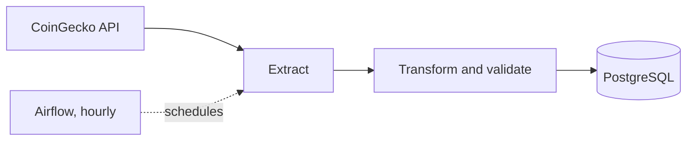

# Crypto Market Data Pipeline

An automated ETL pipeline that collects cryptocurrency market data every hour, validates it, and stores the history in PostgreSQL.

## Architecture



## Tech stack
Python, pandas, PostgreSQL, SQLAlchemy, Docker, Apache Airflow, pytest

## Features
- Extracts the top 20 coins by market cap
- Cleans the data and checks it for invalid values
- Idempotent loading (safe to re-run, no duplicates)
- Hourly scheduling with retries through Airflow
- Fully containerized

## How to run
1. Copy `.env.example` to `.env` and set a password
2. Start the database and pipeline: `docker compose up --build`
3. Start Airflow:
```
   docker compose up -d db
   docker compose -f docker-compose.airflow.yaml -p airflow-crypto up airflow-init
   docker compose -f docker-compose.airflow.yaml -p airflow-crypto up -d
```
4. Open http://localhost:8080 and enable the `crypto_pipeline` DAG

## Tests
`python -m pytest`

## Project structure
- `src/`: extract, transform, load modules
- `dags/`: Airflow DAG
- `tests/`: unit tests

## What I learned
Building a full ETL pipeline, designing a database table, making loads idempotent, containerizing with Docker, and orchestrating with Airflow.